# 🚦 Traffic Light Controller – Moore FSM

> Bài tập môn Thiết kế số – **Nhóm MCE7**
> Thiết kế bộ điều khiển đèn giao thông bằng máy trạng thái hữu hạn (FSM) kiểu Moore, viết bằng **Verilog HDL** và mô phỏng trên **ModelSim**.

---

## 👥 Thành viên nhóm MCE7

| STT | Họ và tên | MSSV | Vai trò | Công việc chính |
|:---:|-----------|------|---------|-----------------|
| 1 | Lê Nguyễn Quang Huy | SE201771 | Nhóm trưởng | Quản lý repo, review & merge Pull Request; thiết kế **state register** và **next-state logic** |
| 2 | Mai Anh Khoa | SE204346 | Thành viên | Thiết kế **output logic** và tham số thời gian của từng đèn |
| 3 | Nguyễn Duy Khoa | SE204859 | Thành viên | Viết **testbench** tự kiểm tra (PASS/FAIL) |
| 4 | Lê Quốc Anh | SE203918 | Thành viên | Viết **script ModelSim**, chạy mô phỏng, chụp và phân tích dạng sóng |
| 5 | Quách Đăng Khoa | SE204866 | Thành viên | Vẽ **sơ đồ trạng thái**, lập bảng chuyển trạng thái, viết **báo cáo** |

---

## 📖 Giới thiệu

Đèn giao thông là ví dụ kinh điển để làm quen với **máy trạng thái hữu hạn (Finite State Machine – FSM)**. Hệ thống luân phiên qua 3 trạng thái theo một chu trình cố định, mỗi trạng thái được giữ trong một số chu kỳ clock nhất định.

Dự án này giúp nhóm nắm được:

- Cách mô hình hóa một hệ thống tuần tự bằng FSM
- Cấu trúc chuẩn của FSM gồm 3 khối: **state register – next-state logic – output logic**
- Sự khác nhau giữa **Moore FSM** (output chỉ phụ thuộc trạng thái) và Mealy FSM
- Cách viết testbench và kiểm chứng thiết kế bằng mô phỏng
- Cách làm việc nhóm với **Git/GitHub** (branch, commit, Pull Request)

---

## 📋 Đặc tả

### Chu trình hoạt động

```
RED ──► GREEN ──► YELLOW ──► RED ──► ...
```

### Thời gian mỗi trạng thái

| Trạng thái | Số chu kỳ clock | Tham số       |
|------------|:---------------:|---------------|
| 🔴 RED     | 5               | `RED_TIME`    |
| 🟢 GREEN   | 5               | `GREEN_TIME`  |
| 🟡 YELLOW  | 2               | `YELLOW_TIME` |

Một chu trình đầy đủ: **12 chu kỳ clock**.

### Giao tiếp (ports)

| Tín hiệu | Hướng  | Độ rộng | Mô tả |
|----------|--------|:-------:|-------|
| `clk`    | input  | 1 | Xung clock hệ thống |
| `rst`    | input  | 1 | Reset đồng bộ, mức cao – đưa FSM về trạng thái RED |
| `red`    | output | 1 | Đèn đỏ sáng khi = 1 |
| `green`  | output | 1 | Đèn xanh sáng khi = 1 |
| `yellow` | output | 1 | Đèn vàng sáng khi = 1 |

---

## 🔄 Sơ đồ trạng thái

```mermaid
flowchart LR
    RST(( )) -- "rst = 1" --> RED
    RED(("<b>RED</b><br/>S0 = 00<br/>R G Y = 1 0 0<br/>5 chu kỳ"))
    GREEN(("<b>GREEN</b><br/>S1 = 01<br/>R G Y = 0 1 0<br/>5 chu kỳ"))
    YELLOW(("<b>YELLOW</b><br/>S2 = 10<br/>R G Y = 0 0 1<br/>2 chu kỳ"))
    RED -- "done = 1" --> GREEN
    GREEN -- "done = 1" --> YELLOW
    YELLOW -- "done = 1" --> RED
    classDef r fill:#ffd6d6,stroke:#d00,stroke-width:2px,color:#000
    classDef g fill:#d6ffd9,stroke:#090,stroke-width:2px,color:#000
    classDef y fill:#fff4c2,stroke:#c90,stroke-width:2px,color:#000
    classDef s fill:#000,stroke:#000
    class RED r
    class GREEN g
    class YELLOW y
    class RST s
```



**Cách đọc sơ đồ:**
- Mỗi **vòng tròn** là một trạng thái, ghi lần lượt: tên – mã hóa – output – thời gian giữ.
- Mỗi **mũi tên** là một lần chuyển trạng thái, nhãn ghi điều kiện chuyển.
- Khi `done = 0`, FSM **giữ nguyên** trạng thái hiện tại (không vẽ vòng tự lặp cho gọn).
- Output được ghi **bên trong** vòng tròn vì đây là **Moore FSM**: output chỉ phụ thuộc trạng thái.

### Bảng 1 – Mã hóa trạng thái và output

| Trạng thái | `state[1:0]` | `red` | `green` | `yellow` | Thời gian giữ |
|:----------:|:------------:|:-----:|:-------:|:--------:|:-------------:|
| 🔴 RED     | `00` | **1** | 0 | 0 | 5 chu kỳ |
| 🟢 GREEN   | `01` | 0 | **1** | 0 | 5 chu kỳ |
| 🟡 YELLOW  | `10` | 0 | 0 | **1** | 2 chu kỳ |
| *(không dùng)* | `11` | 1 | 0 | 0 | → về RED |

### Bảng 2 – Chuyển trạng thái (next-state)

| Trạng thái hiện tại | `done = 0` | `done = 1` |
|:-------------------:|:----------:|:----------:|
| 🔴 RED    | RED    | 🟢 GREEN  |
| 🟢 GREEN  | GREEN  | 🟡 YELLOW |
| 🟡 YELLOW | YELLOW | 🔴 RED    |

### Tín hiệu `done`

```
done = (cnt == thời_gian_của_trạng_thái_hiện_tại − 1)
```

Bộ đếm `cnt` tăng 1 mỗi chu kỳ clock. Khi `done = 1`, ở cạnh clock kế tiếp FSM chuyển trạng thái và `cnt` quay về 0.

---

## 🏗️ Kiến trúc thiết kế

```
            ┌─────────────────────┐
            │  NEXT-STATE LOGIC   │◄──── cnt / done
            │    (tổ hợp)         │
            └─────────┬───────────┘
                      │ next_state
                      ▼
 clk, rst ──►┌─────────────────────┐
            │   STATE REGISTER    │──── state ────┐
            │   + bộ đếm cnt      │               │
            │    (tuần tự)        │               ▼
            └─────────────────────┘    ┌─────────────────────┐
                                       │    OUTPUT LOGIC     │──► red, green, yellow
                                       │ (tổ hợp, chỉ theo   │
                                       │   state → Moore)    │
                                       └─────────────────────┘
```

1. **State register:** cập nhật `state` và bộ đếm `cnt` tại mỗi cạnh lên của `clk`.
2. **Next-state logic:** quyết định trạng thái kế tiếp dựa trên trạng thái hiện tại và tín hiệu `done`.
3. **Output logic:** sinh tín hiệu đèn **chỉ dựa vào trạng thái hiện tại**, nên đây là Moore FSM.

---

## 📁 Cấu trúc thư mục

```
fsm-traffic-light/
├── rtl/
│   └── traffic_light.v       # Thiết kế FSM
├── tb/
│   └── tb_traffic_light.v    # Testbench tự kiểm tra
├── sim/
│   └── run.do                # Script chạy ModelSim
├── docs/
│   ├── waveform/             # Ảnh chụp dạng sóng
│   ├── state_diagram.png     # Sơ đồ trạng thái
│   └── report.md             # Báo cáo
├── .gitignore
└── README.md
```

---

## ▶️ Hướng dẫn mô phỏng

### Yêu cầu
- ModelSim (Intel FPGA Starter Edition hoặc bản tương đương)

### Các bước
1. Clone repo về máy:
   ```bash
   git clone https://github.com/LeNGQHuy/fsm-traffic-light.git
   ```
2. Mở ModelSim → `File > Change Directory...` → chọn thư mục **`sim/`**
3. Trong cửa sổ **Transcript**, gõ:
   ```tcl
   do run.do
   ```
4. Xem dạng sóng ở cửa sổ **Wave** và kết quả kiểm tra ở **Transcript**.

### Kết quả mong đợi

```
clk    : _|‾|_|‾|_|‾|_|‾|_|‾|_|‾|_|‾|_|‾|_|‾|_|‾|_|‾|_|‾|_
red    : ‾‾‾‾‾‾‾‾‾‾‾‾‾‾‾‾‾‾‾‾|____________________________
green  : ____________________|‾‾‾‾‾‾‾‾‾‾‾‾‾‾‾‾‾‾‾‾|_______
yellow : _________________________________________|‾‾‾‾‾‾‾
           ◄──── 5 chu kỳ ────►◄──── 5 chu kỳ ────►◄ 2 ►
```

Testbench sẽ in ra:

```
  [OK]  den 100 sang dung 5 chu ky
  [OK]  den 010 sang dung 5 chu ky
  [OK]  den 001 sang dung 2 chu ky
  ...
==== PASS: khong co loi ====
```

---

<p align="center"><b>Nhóm MCE7</b> · 2026</p>
