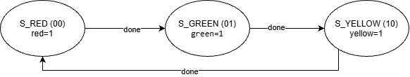

# BÁO CÁO – BỘ ĐIỀU KHIỂN ĐÈN GIAO THÔNG BẰNG MOORE FSM

**Môn:** Thiết kế số  
**Nhóm:** MCE7  
**Công cụ:** Verilog HDL, ModelSim, Git/GitHub  
**Repo:** https://github.com/LeNGQHuy/FSM-Traffic-Light

| STT | Họ và tên | MSSV | Vai trò |
|:---:|---|---|---|
| 1 | Lê Nguyễn Quang Huy | SE201771 | Nhóm trưởng – code RTL, testbench cơ bản, quản lý repo |
| 2 | Mai Anh Khoa | SE204346 | Chạy mô phỏng ModelSim, chụp dạng sóng |
| 3 | Nguyễn Duy Khoa | SE204859 | Testbench mở rộng |
| 4 | Lê Quốc Anh | SE203918 | Sơ đồ trạng thái, bảng trạng thái |
| 5 | Quách Đăng Khoa | SE204866 | Viết báo cáo |

---

## 1. Giới thiệu

### 1.1. Đặt vấn đề

Đèn giao thông là ví dụ kinh điển của **hệ thống tuần tự**: đèn luân phiên qua một số trạng thái cố định theo một thứ tự xác định, mỗi trạng thái được giữ trong một khoảng thời gian nhất định. Bài toán này rất phù hợp để mô hình hóa bằng **máy trạng thái hữu hạn (Finite State Machine – FSM)**.

### 1.2. Mục tiêu

- Mô hình hóa bộ điều khiển đèn giao thông bằng FSM kiểu **Moore**.
- Cài đặt bằng **Verilog HDL** theo cấu trúc chuẩn 3 khối: *state register – next-state logic – output logic*.
- Kiểm chứng thiết kế bằng testbench tự kiểm tra (PASS/FAIL) và quan sát dạng sóng trên **ModelSim**.
- Làm việc nhóm với Git/GitHub (nhánh riêng, commit, Pull Request).

### 1.3. Cơ sở lý thuyết

**FSM** là mô hình gồm một tập hữu hạn các trạng thái, tập tín hiệu vào, hàm chuyển trạng thái và hàm tạo ngõ ra. Có hai kiểu chính:

| Tiêu chí | Moore | Mealy |
|---|---|---|
| Ngõ ra phụ thuộc | Chỉ **trạng thái hiện tại** | Trạng thái hiện tại **và** ngõ vào |
| Độ ổn định ngõ ra | Ổn định, thay đổi cùng cạnh clock | Có thể thay đổi khi ngõ vào đổi |
| Số trạng thái | Thường nhiều hơn | Thường ít hơn |

Bài toán đèn giao thông chọn **Moore** vì mỗi đèn sáng gắn trực tiếp với một trạng thái, ngõ ra sạch và không bị nhiễu do ngõ vào.

Một FSM đồng bộ thường gồm 3 khối:

1. **State register** (tuần tự): lưu trạng thái hiện tại, cập nhật ở cạnh lên của `clk`, có reset.
2. **Next-state logic** (tổ hợp): xác định trạng thái kế tiếp từ trạng thái hiện tại và ngõ vào.
3. **Output logic** (tổ hợp): sinh ngõ ra từ trạng thái hiện tại (Moore).

---

## 2. Đặc tả hệ thống

### 2.1. Chu trình hoạt động

```
RED ──► GREEN ──► YELLOW ──► RED ──► ...
```

### 2.2. Thời gian mỗi trạng thái

| Trạng thái | Số chu kỳ clock | Tham số |
|---|:---:|---|
| RED (đỏ) | 5 | `RED_TIME` |
| GREEN (xanh) | 5 | `GREEN_TIME` |
| YELLOW (vàng) | 2 | `YELLOW_TIME` |

Một chu trình đầy đủ gồm **5 + 5 + 2 = 12 chu kỳ clock**.

### 2.3. Giao tiếp (ports)

| Tín hiệu | Hướng | Độ rộng | Mô tả |
|---|---|:---:|---|
| `clk` | input | 1 | Xung clock hệ thống |
| `rst` | input | 1 | Reset đồng bộ, mức cao, đưa FSM về trạng thái RED |
| `red` | output | 1 | Đèn đỏ sáng khi bằng 1 |
| `green` | output | 1 | Đèn xanh sáng khi bằng 1 |
| `yellow` | output | 1 | Đèn vàng sáng khi bằng 1 |

---

## 3. Thiết kế FSM

### 3.1. Sơ đồ trạng thái



*Hình 1 – Sơ đồ trạng thái Moore FSM của bộ điều khiển đèn giao thông.*

Mỗi vòng tròn là một trạng thái (tên, mã hóa, ngõ ra, thời gian giữ). Mỗi mũi tên là một lần chuyển trạng thái, nhãn là điều kiện chuyển. Khi `done = 0`, FSM giữ nguyên trạng thái hiện tại. Ngõ ra nằm trong vòng tròn vì đây là Moore FSM.

### 3.2. Bảng mã hóa trạng thái và ngõ ra

| Trạng thái | `state[1:0]` | `red` | `green` | `yellow` | Thời gian giữ |
|:---:|:---:|:---:|:---:|:---:|:---:|
| RED | `00` | **1** | 0 | 0 | 5 chu kỳ |
| GREEN | `01` | 0 | **1** | 0 | 5 chu kỳ |
| YELLOW | `10` | 0 | 0 | **1** | 2 chu kỳ |
| *(không dùng)* | `11` | 1 | 0 | 0 | quay về RED |

Dùng 2 bit để mã hóa 3 trạng thái. Mã `11` không thuộc chu trình; thiết kế xử lý bằng cách đưa về RED để hệ thống tự phục hồi nếu rơi vào trạng thái không hợp lệ.

### 3.3. Bảng chuyển trạng thái

| Trạng thái hiện tại | `done = 0` | `done = 1` |
|:---:|:---:|:---:|
| RED | RED | GREEN |
| GREEN | GREEN | YELLOW |
| YELLOW | YELLOW | RED |

### 3.4. Tín hiệu `done` và bộ đếm thời gian

Mỗi trạng thái cần giữ một số chu kỳ xác định nên thiết kế dùng thêm bộ đếm `cnt`:

```
done = (cnt == thời_gian_của_trạng_thái_hiện_tại − 1)
```

- `cnt` tăng 1 sau mỗi chu kỳ clock.
- Khi `done = 1`, ở cạnh clock kế tiếp FSM chuyển sang trạng thái mới và `cnt` quay về 0.
- Khi `rst = 1`, FSM về RED và `cnt = 0`.

### 3.5. Kiến trúc 3 khối

```
            ┌─────────────────────┐
            │  NEXT-STATE LOGIC   │◄──── cnt / done
            │    (tổ hợp)         │
            └─────────┬───────────┘
                      │ next_state
                      ▼
 clk, rst ──►┌─────────────────────┐
            │   STATE REGISTER    │──── state ────┐
            │   + bộ đếm cnt      │               │
            │    (tuần tự)        │               ▼
            └─────────────────────┘    ┌─────────────────────┐
                                       │    OUTPUT LOGIC     │──► red, green, yellow
                                       │ (tổ hợp, chỉ theo   │
                                       │   state → Moore)    │
                                       └─────────────────────┘
```

| Khối | Loại | Chức năng |
|---|---|---|
| State register + `cnt` | Tuần tự | Cập nhật `state`, `cnt` tại cạnh lên `clk`; reset đồng bộ |
| Next-state logic | Tổ hợp | Chọn trạng thái kế tiếp theo `state` và `done` |
| Output logic | Tổ hợp | Sinh `red`, `green`, `yellow` chỉ từ `state` |

Các tham số `RED_TIME`, `GREEN_TIME`, `YELLOW_TIME` khai báo bằng `parameter` nên có thể thay đổi thời gian mà không sửa cấu trúc thiết kế (được tận dụng ở Test 2 của testbench mở rộng).

---

## 4. Kết quả mô phỏng

### 4.1. Môi trường và cách chạy

- Công cụ: ModelSim.
- Mở ModelSim → `File > Change Directory...` → chọn thư mục `sim/` → gõ `do run.do` trong Transcript.

### 4.2. Kết quả mong đợi theo lý thuyết

| Chu kỳ clock | 1 – 5 | 6 – 10 | 11 – 12 | 13 |
|---|:---:|:---:|:---:|:---:|
| Trạng thái | RED | GREEN | YELLOW | RED (lặp lại) |
| `red green yellow` | 1 0 0 | 0 1 0 | 0 0 1 | 1 0 0 |

### 4.3. Testbench cơ bản (`tb/tb_traffic_light.v`)

Testbench tự kiểm tra, đo số chu kỳ mà mỗi đèn sáng và in kết quả:

```
  [OK]  den 100 sang dung 5 chu ky
  [OK]  den 010 sang dung 5 chu ky
  [OK]  den 001 sang dung 2 chu ky
  ...
==== PASS: khong co loi ====
```

> **[TODO – Anh Khoa]** Dán ảnh chụp Transcript hiển thị kết quả PASS tại đây.

### 4.4. Dạng sóng

> **[TODO – Anh Khoa]** Thêm 2 ảnh vào `docs/waveform/`, sửa tên file trong 2 dòng ảnh dưới cho đúng.


*Hình 2 – Dạng sóng toàn bộ chu trình RED → GREEN → YELLOW → RED.*


*Hình 3 – Dạng sóng tại thời điểm chuyển trạng thái.*

**Nhận xét:**

- Đèn đỏ sáng 5 chu kỳ, sau đó đèn xanh sáng 5 chu kỳ, cuối cùng đèn vàng sáng 2 chu kỳ, đúng đặc tả.
- Tại mọi thời điểm chỉ có **một** đèn sáng.
- Ngõ ra thay đổi cùng cạnh lên của `clk` khi `state` đổi, đúng đặc trưng của Moore FSM (ngõ ra chỉ phụ thuộc trạng thái).
- Sau YELLOW hệ thống quay về RED, chu trình lặp lại với chu kỳ 12 clock.

> **[TODO – Anh Khoa]** Bổ sung nhận xét riêng từ ảnh sóng thực tế nếu có điểm đáng chú ý.

### 4.5. Testbench mở rộng (`tb/tb_extra.v`)

Testbench mở rộng do Nguyễn Duy Khoa (SE204859) viết. File tạo **hai bản** `traffic_light` chạy song song trên cùng một clock (chu kỳ 10 ns): `dut1` dùng thời gian mặc định (5, 5, 2) cho Test 1, `dut2` dùng thời gian (3, 4, 1) cho Test 2. Mỗi test tự đối chiếu kết quả và cộng dồn số lỗi vào biến `errors`.

| Test | Mô tả | Cách kiểm tra | Kết quả mong đợi |
|---|---|---|---|
| Test 1 | Bấm `rst` khi đèn đang xanh | Chờ `green = 1`, để xanh sáng thêm 2 chu kỳ rồi đặt `rst = 1`. Sau 1 chu kỳ clock kiểm tra ngõ ra, sau đó giữ reset thêm 3 chu kỳ và kiểm tra lại | `red = 1`, `green = 0`, `yellow = 0` ngay sau reset và trong suốt lúc giữ reset |
| Test 2 | Đổi tham số `RED_TIME = 3`, `GREEN_TIME = 4`, `YELLOW_TIME = 1` | Đếm số chu kỳ liên tiếp mà mỗi đèn sáng, so với 3, 4, 1 mỗi khi đèn đổi trạng thái; đồng thời kiểm tra mỗi chu kỳ chỉ có đúng 1 đèn sáng | Đỏ 3, xanh 4, vàng 1 chu kỳ (tổng 8 chu kỳ). Testbench chạy 2 vòng đầy đủ cộng thêm 1 chu kỳ (17 chu kỳ) |

**Kết quả:** Theo ghi chú của tác giả trong file, mô phỏng trên ModelSim cho kết quả **PASS** ở cả hai test, cuối cùng testbench in ra `==== PASS: khong co loi ====`.

**Ý nghĩa:**

- Test 1 xác nhận reset có tác dụng ngay cả khi FSM đang ở giữa chu trình (trạng thái GREEN) và FSM giữ ở RED khi reset còn được giữ.
- Test 2 xác nhận thiết kế dùng `parameter` đúng cách: đổi thời gian mà không cần sửa cấu trúc FSM, bộ đếm `cnt` và tín hiệu `done` vẫn hoạt động đúng với thời gian mới.
- Testbench ghi thêm file dạng sóng `tb_extra.vcd` bằng `$dumpfile` và `$dumpvars`, có thể mở lại để xem.

> **[TODO]** Nếu Duy Khoa gửi ảnh Transcript của ModelSim, lưu vào `docs/waveform/tb_extra_transcript.png` và thêm dòng: ``

---

## 5. Kết luận

### 5.1. Kết quả đạt được

- Thiết kế hoàn chỉnh bộ điều khiển đèn giao thông bằng Moore FSM với 3 trạng thái RED, GREEN, YELLOW.
- Cài đặt bằng Verilog theo cấu trúc 3 khối, thời gian từng đèn cấu hình được qua `parameter`.
- Mô phỏng trên ModelSim cho kết quả đúng đặc tả (5 – 5 – 2 chu kỳ, tổng 12 chu kỳ), testbench báo PASS.
- Có xử lý reset đồng bộ và trạng thái không dùng (`11`).
- Nhóm làm việc theo quy trình Git: mỗi thành viên một nhánh, Pull Request để nhóm trưởng duyệt.

### 5.2. Hạn chế

- Mô hình chỉ có một cụm đèn, chưa mô phỏng ngã tư với hai hướng đối nhau.
- Thời gian các đèn cố định, chưa thay đổi theo mật độ giao thông.
- Mới kiểm chứng bằng mô phỏng, chưa nạp lên FPGA.

### 5.3. Hướng phát triển

- Mở rộng thành ngã tư 2 hướng có phối hợp đèn.
- Thêm cảm biến phương tiện và nút bấm cho người đi bộ.
- Thêm chế độ nhấp nháy vàng ban đêm.
- Tổng hợp và nạp lên kit FPGA để chạy thực tế.

---

## Phụ lục – Cấu trúc thư mục

```
fsm-traffic-light/
├── rtl/
│   └── traffic_light.v        # Thiết kế FSM
├── tb/
│   ├── tb_traffic_light.v     # Testbench cơ bản
│   └── tb_extra.v             # Testbench mở rộng
├── sim/
│   └── run.do                 # Script chạy ModelSim
├── docs/
│   ├── waveform/              # Ảnh dạng sóng
│   ├── state_diagram.png      # Sơ đồ trạng thái
│   ├── state_table.md         # Bảng trạng thái
│   └── report.md              # Báo cáo này
└── README.md
```
